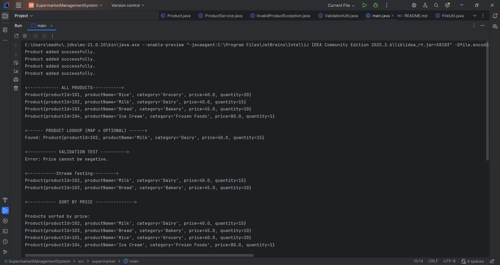
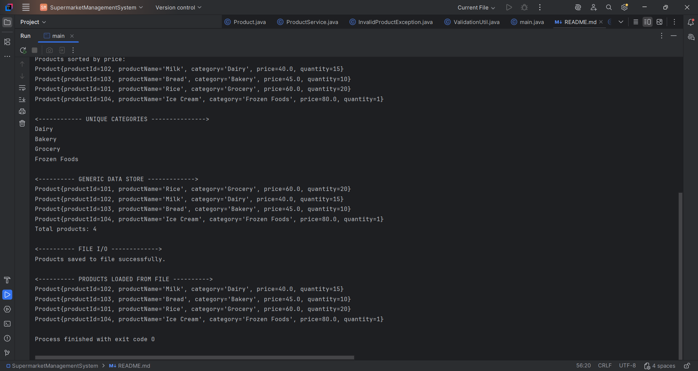

# Supermarket Management System

A small Java console application for managing supermarket products. It demonstrates Java collections, generics, sorting, streams, optional values, validation, exception handling, and text-file processing.

## Requirements

- Java 8 or newer
- No external libraries

## Run

Open a terminal at the project root (`SupermarketManagementSystem`) and run:

```powershell
javac -d out -sourcepath src src/supermarket/main.java
java -cp out supermarket.main
```

The project includes a Code Runner workspace setting in `.vscode/settings.json`. Open the project root as the VS Code
workspace before using **Run Code** on `src/supermarket/main.java`; compiling that file by itself from its package
directory will not include its dependencies.

## Topics Covered

- **Collections:** A `List` keeps the product catalog, a `Map` finds products by ID, and a `Set` keeps category names unique.
- **Generics:** `DataStore<T>` shows how one reusable class can store products while retaining their type.
- **Sorting and comparators:** Products can be ordered by name, price, or quantity, including price from highest to lowest.
- **Lambdas and streams:** Stream filters find products by category or price without writing manual search loops.
- **Optional:** Product lookup returns an `Optional`, so the program handles both a match and a missing ID.
- **Validation and exceptions:** Product data is checked before it is accepted; invalid data raises `InvalidProductException` with a useful message.
- **File processing:** Products are saved to `Project.txt` and read back as product objects. Invalid file rows are skipped and reported.

## Test Cases

### 1. Add, search, validate, filter, and sort products

The first screenshot shows these steps:

1. Four product objects are added and printed. The catalog is stored in a `List<Product>`.
2. Product ID `102` is found through the `Map<Integer, Product>`. The result is returned as an `Optional<Product>`, and the output shows the found product.
3. A product with a negative price is rejected. `ValidationUtil` detects the invalid value and `InvalidProductException` is caught and displayed.
4. A Stream API filter finds products priced below `50`. The filter uses a lambda expression; Milk and Bread are the matching results.
5. A price comparator sorts the products from lowest to highest price. The output shows Milk, Bread, Rice, then Ice Cream.



### 2. Collect categories, use generics, and process the file

The second screenshot shows these steps:

1. The category list contains each category once. A `Set<String>` removes duplicates.
2. `DataStore<Product>` stores and prints four products. This demonstrates a generic class that keeps the stored item type as `Product`; `size()` reports the count.
3. The products are written to `Project.txt` as pipe-separated fields: ID, name, category, price, and quantity.
4. The file is read back and each valid row is parsed into a `Product` object. The loaded products are printed, demonstrating structured file input as well as output.

Together, the examples demonstrate the required collections (`List`, `Map`, and `Set`), generics, comparators, lambdas, streams, `Optional`, validation, exception handling, and file processing.



## Data format

`Project.txt` contains one product per line, with five pipe-separated fields:

```text
productId|productName|category|price|quantity
```

Running the application saves the current product list to this file, replacing its previous contents.

## Source layout

```text
src/supermarket/
  main.java
  exception/InvalidProductException.java
  model/Product.java
  service/ProductService.java
  util/ComparatorUtil.java
  util/DataStore.java
  util/FileUtil.java
  util/ValidationUtil.java
```
